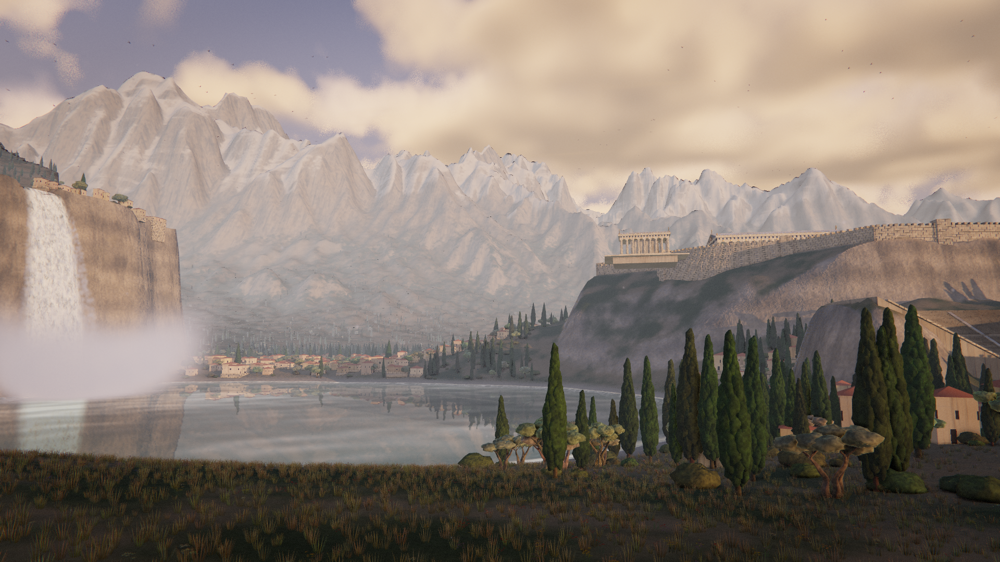
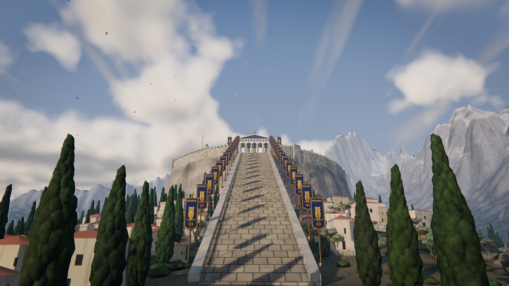
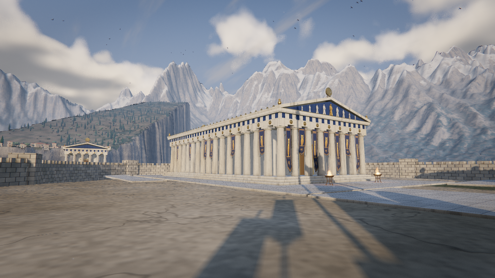
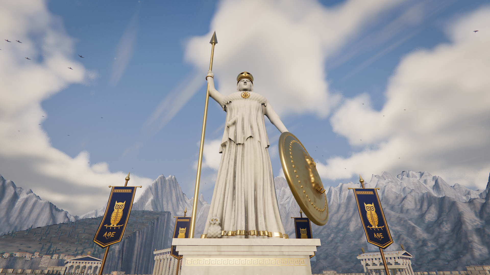
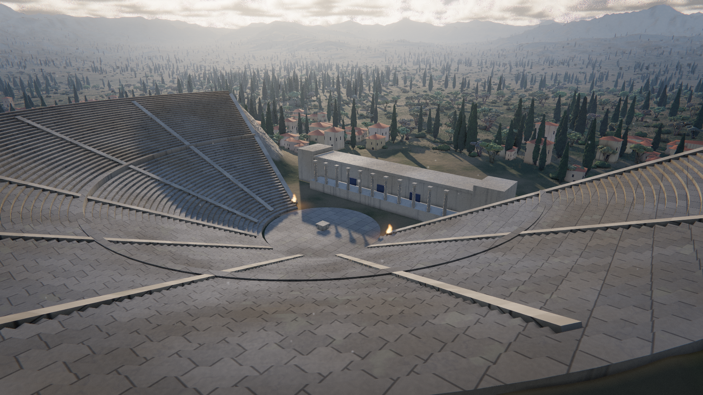
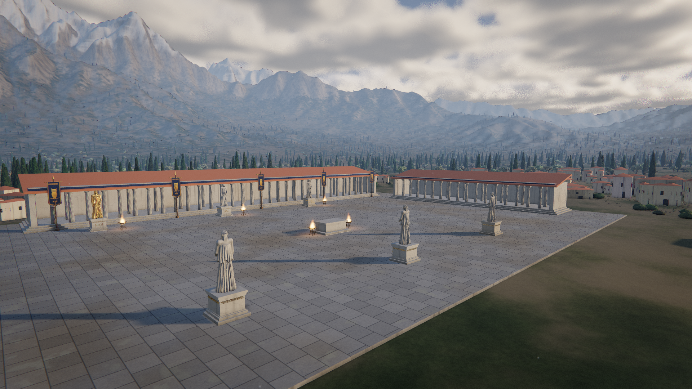
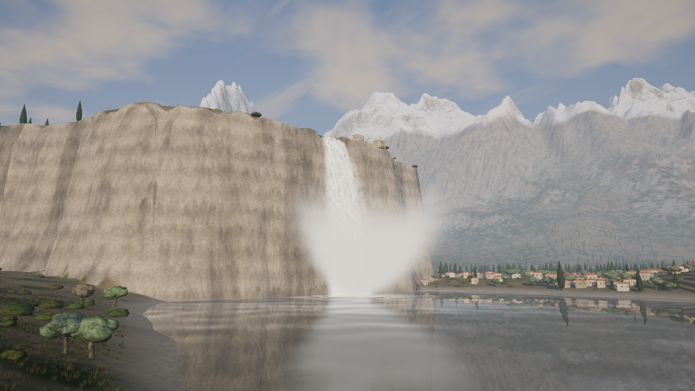
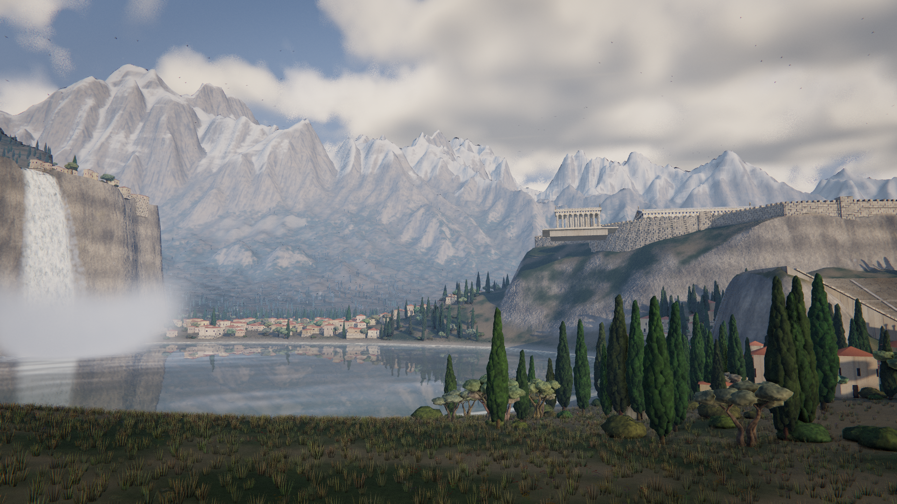
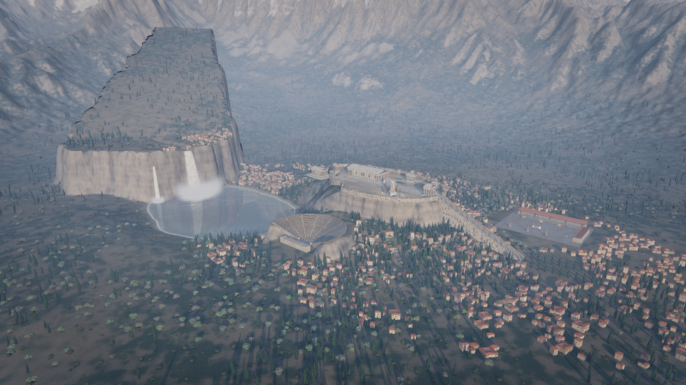

<div align="center">

# 🏛️ Athenaion

### An ancient Greek world, built entirely by Grok

**Every mountain, temple, statue, tree, waterfall and cloud here is generated in code.**
**There are zero external assets: no models, textures, HDRIs or images.**




</div>

## ✨ Made by Grok

All of the code, shaders, geometry and renders in this repo were designed, written, tested and committed by **Grok Bot**, Perseus's AI software engineer ("Builder"). Perseus gave the creative direction, and Grok built the world from an empty folder. Grok checked its own work with headless renders and refined it over several passes.

| | |
| --- | --- |
| **AI** | Grok Bot (Builder agent) |
| **Direction** | Perseus · Perseus Research Lab |
| **Engine** | Three.js + custom GLSL, bundled with Vite |
| **Assets** | None. Everything is procedural. |

## 🖼️ Gallery

| | |
| --- | --- |
|  |  |
| **Grand stairway** lined with owl banners | **The Parthenon**, with relief pediment and gold acroteria |
|  |  |
| **Athena Parthenos**, sculpted from signed distance fields | **Theatre** carved into the hillside |
|  |  |
| **Agora** with stoas and statues | **Twin waterfalls** with sunlit mist |
|  |  |
| **Vista** across the lake | **Aerial** view of the city |

## 🧠 How it's made

- **Terrain:** noise-based heightfields with hydraulic and thermal erosion, rock strata, and snow that drifts and sparkles.
- **Statues:** Athena and the caryatids are defined as signed distance fields (shapes described by math) and meshed with surface nets.
- **Architecture:** fluted Doric columns with entasis, triglyphs, pediments, the Erechtheion, a theatre, stoas and a terraced town, all built from procedural geometry.
- **Vegetation:** instanced cypress, olive trees and wildflowers that sway in the wind, with simpler stand-ins baked at runtime for distant trees.
- **Water and sky:** a mirror lake with caustics and shoreline foam, soft-particle mist, raymarched clouds, god rays and aerial perspective.

## Run

```bash
npm install
npm run dev                # http://localhost:5173
npm run build && npm run serve   # static server for dist/ on http://localhost:4173
```

Also open `/lab.html` for the statue lab (`?view=full|face|helmet|owl|pedestal|chest`).

### URL params

| Param | Values | Notes |
| --- | --- | --- |
| `quality` | `low`, `high` (default), `ultra` | erosion grid, cloud steps, SSAO, god rays, tree/house/flower counts, LOD distances, figure bake resolution. Ultra is heavy. |
| `view` | `vista`, `hero`, `waterfall`, `statue`, `temple`, `stairs`, `sunrays`, `theatre`, `agora`, `aerial` | preset camera |
| `tod` | `day` (default), `noon`, `golden` | sun position, light, fog and sky colours |
| `tour` | `1` | looping spline flythrough of all views; click, Space or Esc hands control back |
| `tourDuration`, `tourAt` | seconds | tour loop length (default 110) and start offset |
| `clouds` | integer | raymarch steps for the cumulus layer (0 disables it) |
| `time` | seconds | freeze animation at that time |
| `exposure` | e.g. `0.62` | tone-mapping exposure |
| `w`, `h` | pixels | fixed canvas size |
| `gui` | `0` | hide lil-gui |

## Render stills

```bash
npm run build
npm run render -- --quality=high --views=vista,hero,waterfall --w=1920 --h=1080
```

Uses puppeteer-core with a local Chrome/Chromium (`CHROME_PATH` to override). SwiftShader by default; add `--gpu=true` to use the real GPU. Output goes to `renders/[page-]<view>-<quality>[-suffix].png`. Options: `--out`, `--suffix`, `--time`, `--port`, `--page=lab.html`, `--params=tod=golden&clouds=24` (extra URL params). A view of `tour@<seconds>` poses the camera on the flythrough. Only the final stills (`renders/vista.png`, `hero`, `temple`, `statue`, `waterfall`, `theatre`, `agora`, `vista-golden`, `aerial`) are tracked; everything else in `renders/` is gitignored.

## Features

- **Statue**: Athena Parthenos baked from SDFs with high-res detail boxes (face, Corinthian helmet, gorgoneion aegis with snakes, owls, gold hems) and an inscribed, meander-banded pedestal. Caryatids and korai reuse the SDF figure kit.
- **City**: Parthenon with navy-painted tympana, marble pediment figures with a gilt centre, owl banners and long drapes; Propylaea, Nike temple, Zeus temple, Erechtheion with a six-caryatid porch; a theatre carved into the hillside (tiered cavea, aisles, orchestra, skene); an agora with two stoas, an altar and six labelled statues on plinths; bronze braziers with flickering soft-particle flames and ground glow; a dense terraced town of block, L and courtyard houses on ashlar podia.
- **Terrain**: fBm + ridged mountains with hydraulic droplet and thermal erosion, strata, gullies, scree, wind-blown sparkling snow, LOD-faded micro detail and underwater caustics.
- **Vegetation**: clumped Italian cypress, gnarled split-trunk olives with silvery sheen, shrubs, grass and four kinds of wildflower drifts. All of it sways in travelling wind gusts. Trees use three LODs; the far one is a runtime-baked albedo and normal-map impostor.
- **Water**: Water.js mirror lake with baked depth (shallow tint, transparency, animated shoreline foam), flow-mapped stream with bank foam, two waterfalls with plunge foam and lit soft-particle mist and spray (Henyey-Greenstein scattering, rainbow hint).
- **Atmosphere**: raymarched cumulus with a cirrus layer, Rayleigh/Mie-style height fog, god rays, GTAO, bloom with HDR clamp, filmic grade, bird flocks, dust motes and time-of-day presets.
- **Camera**: preset views and a `?tour=1` centripetal Catmull-Rom flythrough.

## Structure

```
index.html  vite.config.js  package.json
src/
  main.js        renderer, scene assembly, controls, render loop
  config.js      world layout, sun/atmosphere, quality presets
  views.js       preset camera views
  materials.js   shared material set
  gui.js         lil-gui panel (views, sun, exposure, quality)
  modules/
    utils/        rng (seeded mulberry32), noise (value/perlin, fBm, ridged), math
    terrain/      heightfield (fBm + ridged mountains, acropolis, mesa, lake, theatre bowl, agora), erosion (hydraulic + thermal),
                  terrainMesh (non-uniform LOD grid), terrainMaterial (grass/dirt/rock/snow by height+slope, triplanar-ish fissures, bump)
    architecture/ column (fluted Doric, entasis, echinus, abacus), temple (stylobate, peristyle, entablature, triglyphs, pediment,
                  roof, pediment sculpture), ornaments, walls, banners, town, theatre, stoa, agora, erechtheion, brazier, acropolis (assembly)
    statues/      sdf primitives, figure + athenaSdf, caryatid (kore/caryatid kit), surfaceNets mesher, bakeSdf (+ detail boxes), pedestal, athena
    vegetation/   treeGeometry (clumped cypress, gnarled olive, shrub, grass, wildflowers), foliageMaterial, wind (vertex sway),
                  impostor (baked albedo+normal billboards), scatter (density rules, clearings, distance LOD)
    water/        lake (Water.js mirror with procedural normals, or cheap PBR fallback), stream, waterfall (scrolling foam), mist (instanced spray)
    atmosphere/   sky (dome, raymarched clouds, env bake), lights, fog (height fog, aerial perspective), softParticles, birds, dust,
                  post (scene+depth, GTAO, soft particles, god rays, clamp, bloom, grade)
    tour.js       spline flythrough
    materials/    marble (veining, weathering, streaks, lichen, cavity dirt), gold, stone (ashlar), banner (waving cloth), owlEmblem (canvas), waterNormals, glsl helpers
tools/
  serve.js   plain node static server
  render.js  headless screenshot capture
```

## Known limitations

- One heightfield mesh with no chunking. Erosion only runs inside a central grid.
- Waterfall mist reads as a soft cotton-ball volume from far or high above.
- Impostors bake a single side view, so they don't swing correctly from steep top-down angles. Shadows ignore wind sway.
- Town houses are boxes with tile-coloured roofs, without proper ridged roof geometry. Roads aren't modelled.
- The tour clamps height above terrain but doesn't avoid buildings or trees.
- SwiftShader renders take about 30 to 60 s per high-quality 1080p frame plus about 45 s of scene build. Ultra is much slower.

## Roadmap (prioritized)

1. Terrain chunking + CDLOD and a GPU heightfield for a larger world; extend erosion to the whole map.
2. Volumetric, raymarched mist for the plunge pool; wet-rock darkening.
3. Ridged roof tiles, roads and per-building weathering; Ionic order for the Erechtheion.
4. Multi-angle (octahedral) impostors; wind-aware shadow depth materials.
5. Path-traced hero stills; video capture of the tour.
6. Weather presets (storm, haze, night with lit braziers).

